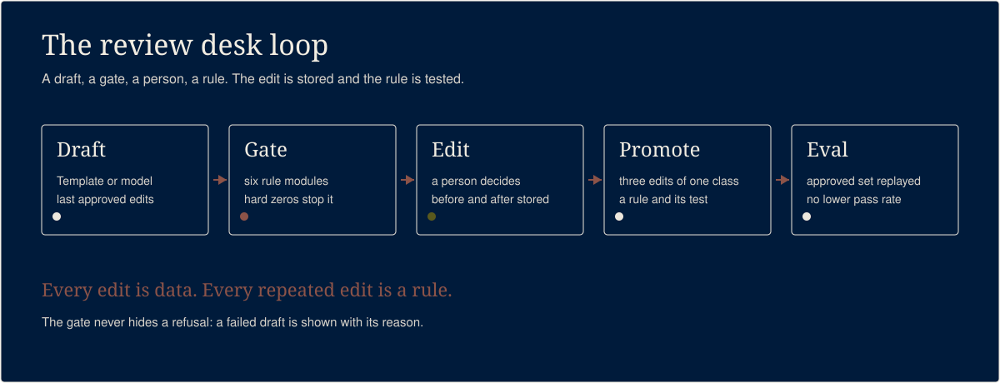

# review-desk

A model drafts the reply. A human approves or edits it. Every edit becomes data: a few-shot example
for the next draft and, when it repeats, a rule the draft must pass before a human sees it. An eval
runs over the growing set and must not get worse. This is the learning loop I run my business on,
shown on invented reviews.

## What it does



A small local web app for answering reviews with a loop that learns. The reviews, the bakery and
every person in them are invented by a fixed-seed generator. Nothing is posted anywhere.

Three surfaces:

| Surface | What it shows |
|---|---|
| Queue at `/` | Every review, the draft, and the gate result. A refused draft shows its rule and reason. |
| Edit view at `/review/<id>` | The review, the draft before, your reply after, and every edit stored for that review. |
| Rules page at `/rules` | Every rule module, plus any rule a repeated correction has proposed. |
| Eval at `/eval` | The approved set replayed through the current drafter. |

With no model, a deterministic template drafter writes the reply from the rating, the topic, the
review language and the reviewer's first name. With `LLM_URL` set to an OpenAI-compatible endpoint,
a model drafts instead and the last approved edits for that topic ride along as examples. Either
way, the gates run before a person sees the draft.

## How it works

```
review --> draft --> gate --> approve
              ^         |         |
              |         v         v
         few-shot   refused   person edits
              ^                   |
              |                   v
           promote <---- 3 edits of one class
              |
              v
             eval
```

- `lib/reviews.mjs` invents the bakery and 124 reviews at seed 7. The hard cases ship with it: a
  refund request, a review that names a staff member, Spanish reviews and an abusive one.
- `rules/` holds one module per rule. Every module exports `check(review, draft)` and answers
  `{ pass, reason }`. A failing rule never hides: its id and reason are printed and shown.
- `lib/rule-runner.mjs` reads every module in `rules/` at gate time, so a rule a person installs is
  enforced on the next draft with no code change. The shipped six run first in a fixed order; a
  promoted rule follows. The first failure is the gate's one line.
- `lib/promote.mjs` reads the stored edits. When one correction class appears three times, it
  writes a rule module and a node:test file that travels with it. The rule is derived from the
  edits: the longest phrase every corrected reply shares and no original draft has.
- `lib/eval.mjs` replays the approved set through the current drafter and the current gates. It
  fails on a lower pass rate or any hard-zero hit.
- `scripts/server.mjs` serves the three surfaces on `localhost`. Reviews, drafts and proposals live
  in SQLite under `data/`. Every edit is appended to `data/edits.json`, the same log the few-shot
  drafter and `scripts/promote.mjs` read. Approval runs every rule on the exact text; a failed rule
  returns HTTP 422 with the rule and reason and stores nothing.

## Run it

```bash
npm ci
npm start
```

Then open `http://localhost:3000`. `PORT` changes the port. The app needs Node 22.5 or newer
because it stores data with `node:sqlite`. The command line loop below runs on Node 20.

## The loop

1. **Draft.** `node scripts/draft.mjs --reviews data/reviews.json --out data/drafts.json` writes one
   reply per review. The template drafter needs no model. `REVIEW_DESK_DRAFTER=<path>` swaps in
   another module that default-exports `(review) => string`.
2. **Gate.** `node scripts/gate.mjs --review <review.json> --draft <draft.txt>` prints `PASS` or one
   line `FAIL <rule>: <reason>`. The batch form writes one verdict per draft.
3. **Edit.** A person approves or edits in the web app. `scripts/edit.mjs` does the same from the
   command line and stores the before and the after with a correction class.
4. **Promote.** `node scripts/promote.mjs --edits data/edits.json --out data/proposed` prints one
   line `PROPOSED <n>`. Three edits of one class write exactly two files: the rule and its test.
   Two edits write nothing.
5. **Eval.** `npm run eval` prints one `EVAL PASS <rate>` line or one `EVAL FAIL <reason>` line and
   exits non-zero on a regression.

A recording of the loop, from draft to edit to a proposed rule: [docs/img/demo.gif](docs/img/demo.gif).

The whole loop with no model and no key:

```bash
node scripts/generate-reviews.mjs --seed 7 --out data/reviews.json
node scripts/draft.mjs --reviews data/reviews.json --out data/drafts.json
node scripts/gate.mjs --reviews data/reviews.json --drafts data/drafts.json --out data/gated.json
node scripts/approve.mjs --reviews data/reviews.json --drafts data/drafts.json --out data/approved.json
npm run eval
```

## The rules

| Id | Kind | What it refuses |
|---|---|---|
| `no-money` | hard zero | A currency amount or a money promise: refund, reimbursement, comp, free item, store credit, voucher, coupon, gift card, discount, half price, percent off. English, Spanish and French keywords, accent-insensitive. |
| `no-staff-surname` | hard zero | A staff member's surname, even split by a line break, hyphen, soft hyphen, space or zero-width character. The first name is allowed. |
| `language-match` | hard zero | A reply in a different language from the review, a reply with more than 20 percent of its scored words in a second language, or a text whose language cannot be recognised. |
| `no-medical-legal` | gate | A medical claim (cure, treats, heals, diagnoses, medical advice) or a legal claim (lawyers, attorneys, legally, liable, liability, not responsible, lawsuit, sue, court). |
| `length` | gate | A reply under 40 or over 600 characters after trimming. |
| `numbers-from-review` | gate | A digit or a number word the review never states, in the same form or the same value. The word "one" is not counted: in a reply it is nearly always a pronoun. |

The money rule reads English, Spanish and French keywords. The language rule scores English,
Spanish, French, German, Italian and Portuguese. These are keyword and pattern checks that a person
backs up, not a guarantee. A money promise worded around the lists still needs the person reading
the draft.

A hard-zero rule blocks approval. Approval runs every rule on the exact text and a failure returns
HTTP 422 with the rule and reason; nothing is stored. The gate stops at the first failure, so the
reason a person sees is the one that matters most. A promoted rule arrives as code and a test, a
person installs it from the rules page, and the gate reads it from `rules/` on the next draft.

## Tests

[](https://github.com/jaysueno/review-desk/actions/workflows/ci.yml)

```bash
npm ci
npm test
npm run eval
```

The suite runs on `node:test`. It proves the generator is byte-identical at seed 7, that every rule
refuses its planted failure and accepts its passing draft, and that the template drafter passes
every rule on every invented review. It runs the grader's 47 attack cases, one table, with the
verdict each rule must give. It proves a split surname, a mixed-language reply, a fullwidth digit
and a number word are caught, that a promoted rule joins the gate, that approval refuses a money
promise with 422, and that the edit log is shared. It regenerates `evals/golden.json` from
`scripts/make-golden.mjs` and compares the bytes. The eval test proves a worse drafter lowers the
rate and fails the run.

## What it will not do

- It never posts a reply anywhere. The app has no outbound call. The model path talks only to the
  `LLM_URL` you name, and only when you set it.
- It ships no real review, real person, real business or address. Everything comes from the
  fixed-seed generator or from the invented approved set in `evals/`.
- It makes no paid model call by default. With no `LLM_URL`, the template drafter does the work.
- It does not guarantee a safe reply. The rules are keyword and pattern checks that a person backs
  up. A promise, claim or language the lists miss is still the person's to catch.
- It never approves a text that fails any rule. A hard-zero failure returns HTTP 422 and nothing is
  stored. No flag or environment variable changes a rule.
- It never writes outside `data/` and the repo's own `rules/` folder when a person installs a
  proposed rule.

## License

MIT. See [LICENSE](LICENSE).
